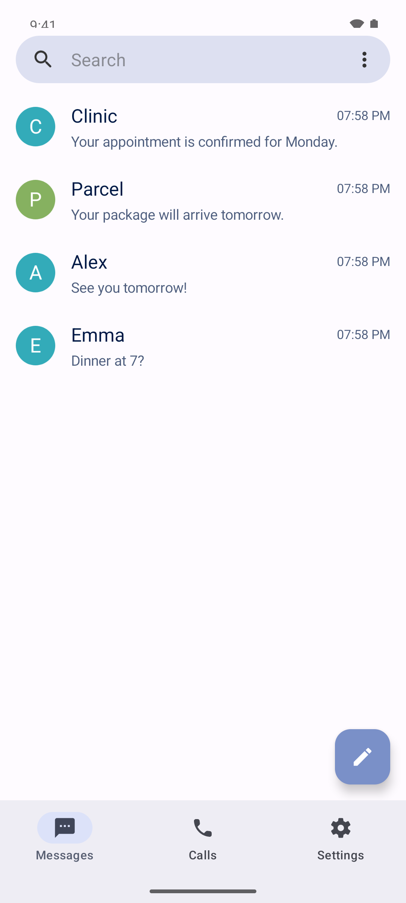
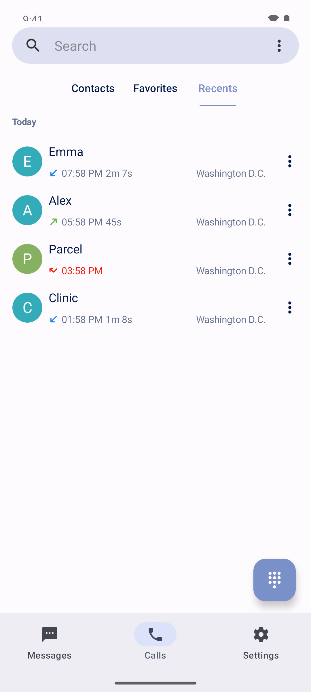
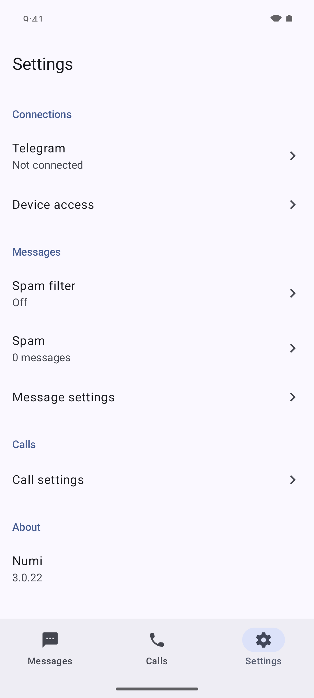

# Numi

An Android SMS and phone app with a Telegram connector and on-device Gemma spam filtering.

[Download APK](https://github.com/bgwastu/numi/releases/latest)

  

Screenshots use dummy data.

Requires Android 8.0 or newer. Set Numi as your default SMS and phone app. Connect a Telegram bot in Settings to access the phone remotely.

Based on [Fossify Messages](https://github.com/FossifyOrg/Messages) and [Fossify Phone](https://github.com/FossifyOrg/Phone). [GPL-3.0](LICENSE).
